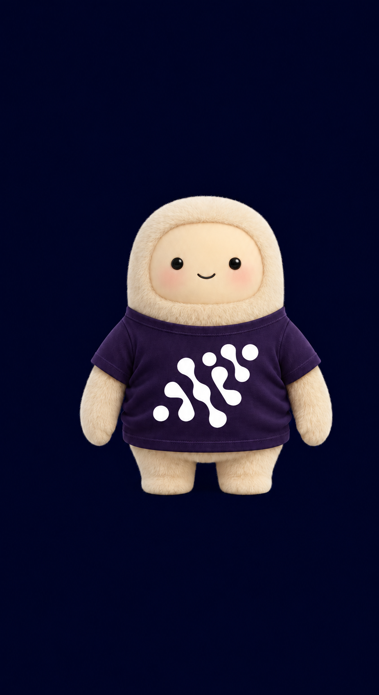
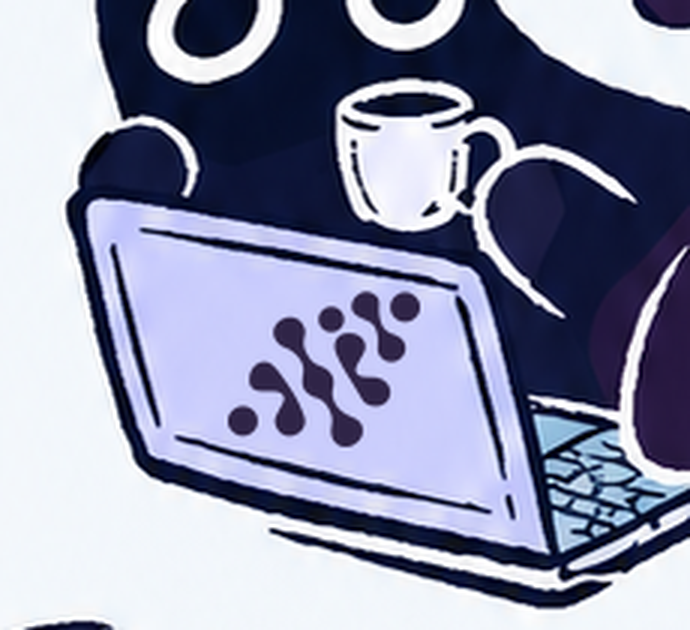

# AIP Restyle

Adapt existing images and designs to the **AI Pioneers / رواد الذكاء الاصطناعي** identity. This agent skill applies the AIP navy-purple palette and bundled team emblem while preserving your subject, original text, composition, and medium.

Use it for photos, illustrations, pixel art, social posts, slides, charts, packaging, and editable SVG or UI designs. The skill includes brand references, ready-to-use palette files, and exact SVG/PNG emblem assets.

<p>
  
  
</p>

Examples of integrated branding. See the [logo workflow](references/logo-workflow.md) for exact compositing and generative mockup options.

[Install](#install) · [Use the skill](#use-the-skill) · [Customize](#customize-the-result) · [Python helpers](#optional-python-helpers) · [Palette](#aip-palette) · [Troubleshooting](#troubleshooting)

## Install

### Codex

You need Node.js and npm for the [Skills CLI](https://skills.sh/docs/cli). From the project where you want to use the skill, run:

```bash
npx skills add https://github.com/Sl-15-dev/sl-skills/tree/main --skill restyle-ai-pioneers --agent codex
```

For a personal installation available across projects:

```bash
npx skills add https://github.com/Sl-15-dev/sl-skills/tree/main --skill restyle-ai-pioneers --agent codex --global
```

Add `--yes` to skip installation prompts. Reload skills or start a new agent session after installing.

**The skill identifier is `restyle-ai-pioneers`.** Use it in `--skill` and in prompts, even though this repository's folder is named `AIP-restyle` and the display name is AIP Restyle.

### Other agents and manual installation

Omit `--agent codex` to choose another agent supported by the CLI, or replace it with a supported identifier such as `claude-code` or `cursor`. Skill invocation and image-editing support depend on the host.

For a manual installation, download or clone this repository and copy the complete `AIP-restyle` folder into your host's documented skills directory. For Codex, the personal destination can be `~/.codex/skills/restyle-ai-pioneers/`, with `SKILL.md` directly inside it. Keep `assets/`, `references/`, `scripts/`, and the other package files together. Back up any existing installation before replacing it, then reload skills or start a new session.

The installation provides instructions and assets. Raster restyling uses your agent's image-editing tool; editable designs use the host's native editing tools. The optional Python helper below handles exact-logo placement. Installing the skill does not install an image editor.

## Use the skill

1. **Attach the source** image, design, or editable file. If you also supply references, identify which file should be edited.
2. **Invoke the skill** and describe the desired result. Mention any required logo position, output format, or content that must stay exact.
3. **Review the finished output** at normal viewing size. Check the subject, text, colors, transparency, and logo placement. The original is kept; the result is saved as a new file.

Type these prompts in your agent chat, rather than in a terminal.

### Quick start

```text
Use $restyle-ai-pioneers on this image. Apply the AIP palette with balanced
strength, preserve the subject and original text, and integrate the emblem
into a suitable surface. Keep the original dimensions and transparency.
```

### Put the emblem on an object

```text
Use $restyle-ai-pioneers on this character. Make its T-shirt dark purple and
place the white AIP emblem clearly on the shirt's chest. Preserve the face,
pose, illustration style, and background. Return the final branded PNG.
```

For a laptop or package, name that surface explicitly. The skill uses the bundled emblem, so you do not need to upload a separate logo. See the [shirt example](assets/examples/integrated-shirt.png) and [laptop example](assets/examples/integrated-laptop.png).

### Keep text and data exact

```text
Use $restyle-ai-pioneers on this chart. Apply AIP colors while preserving
every label, number, data point, and meaningful status color. Logo: none.
Keep the source editable and provide a preview.
```

Supply the editable source when exact text or native output matters. Arabic text should retain its wording, shaping, and right-to-left order.

### Preserve a specific medium

```text
Use $restyle-ai-pioneers on this pixel-art sprite. Preserve the pixel grid,
silhouette, dimensions, and transparency. Use discrete AIP colors without
blur or new gradients. Logo: none.
```

You can also ask for a subtle photo treatment that preserves natural skin tones, or an editable SVG restyle that preserves paths and copy. See [edit recipes](references/edit-recipes.md) for guidance by medium.

## Customize the result

These are instructions to include in your prompt, rather than command-line flags.

| Option | Choices | Default behavior |
| --- | --- | --- |
| Strength | `subtle`, `balanced`, `bold` | `balanced`: recolor designed surfaces and supporting elements while preserving the source. |
| Theme | Keep the source, use a light treatment, or use a dark treatment | Keep the source's light/dark balance. |
| Logo | `auto`, `required`, `none` | `auto`: integrate the emblem into a suitable surface or native branding area. |
| Output | Request a format, size, or editable source | Preserve dimensions, aspect ratio, transparency, and medium where the host tools support them. |

An explicit logo or placement request makes that placement required. For example, “put the logo on the laptop lid” means it belongs on the lid. A footer or canvas extension is added only if you request one. With `auto`, a tiny functional asset may omit the logo if it cannot accommodate a readable mark.

Use white emblems on dark navy/purple surfaces and navy or dark purple on pale surfaces. The skill checks proportions, contrast, clear space, and visibility. See the [emblem variants](assets/logos/README.md).

## What's included

| Resource | Contents |
| --- | --- |
| [Skill instructions](SKILL.md) | Inspection, restyling, logo placement, and final-delivery workflow. |
| [Brand identity](references/brand-identity.md) | Palette, typography references, patterns, logo rules, and source notes. |
| [Team emblem](assets/logos/README.md) | White, purple, dark-purple, and navy SVGs and transparent PNGs. |
| [Logo provenance](assets/logos/manifest.json) | Guideline source, original vector geometry, and asset hashes. |
| [Edit recipes](references/edit-recipes.md) | Guidance for photographs, pixel art, vectors, 3D, layouts, charts, and UI. |
| [Final-delivery guide](references/final-delivery.md) | Checks for the actual saved output and displayed preview. |
| [Evaluation cases](references/evaluation.md) | Scenarios for checking visual quality and preservation. |

The emblem's seven original vector shapes were extracted from the bundled guideline. SVGs preserve those curves; PNGs provide real transparency. Font files are referenced, rather than distributed. See [logo provenance and placement](references/logo-workflow.md) for details.

## AIP palette

| Color | Digital HEX |
| --- | --- |
| Midnight navy | `#020624` |
| Deep navy | `#0F1543` |
| Dark purple | `#2F2447` |
| Mid purple | `#4A3B68` |
| Muted blue | `#58709C` |
| Pale blue | `#B7CDDD` |
| Pale lavender | `#D4DAFA` |
| Cool off-white | `#F6F9FC` |

Download the palette as [JSON](assets/palette.json), [CSS](assets/palette.css), [CSV](assets/palette.csv), [GIMP swatches](assets/palette.gpl), [editable SVG](assets/palette.svg), or [PNG swatches](assets/palette.png). Each design uses the colors it needs; it does not need all eight. White `#FFFFFF` is also included for reversed logos.

The bundled digital values resolve two inconsistent labels in the source guideline against its original vector fills. CMYK entries preserve the guide's labels; they are not a new color-managed print specification. See the [identity reference](references/brand-identity.md) for the source evidence.

## Optional Python helpers

Use the helper when you need the exact bundled emblem composited onto a simple, front-facing raster surface. It places the logo; image restyling still uses the host's editing tools.

Requirements: **Python 3.10+** and **Pillow**. From the installed skill directory containing `SKILL.md` and `requirements.txt` (or `AIP-restyle/` in a repository checkout):

```bash
python3 -m venv .venv
.venv/bin/python -m pip install -r requirements.txt
.venv/bin/python scripts/brand_image.py --help
```

On Windows, create the environment with `py -m venv .venv` and use `.venv\Scripts\python.exe` in place of `.venv/bin/python` throughout these examples. Reuse an existing compatible environment when dependencies are already installed.

After visually inspecting your image, select the usable surface as `X Y WIDTH HEIGHT` in image pixels:

```bash
.venv/bin/python scripts/brand_image.py work/shirt.png output/shirt-aip.png \
  --mode surface --region 300 790 410 310 --variant white
```

The filenames and region are illustrative: replace them with your source, a new output path, and coordinates inside your actual image. The region must include room for the emblem and its clear space. Output is PNG, with dimensions and transparency preserved. The helper refuses to overwrite the original or an existing output.

For an existing layout's branding area, use `--mode overlay`. For a transparent logo region, add an intended viewing background such as `--background '#020624'` for contrast checking; it does not fill the transparency. The helper prints a placement report. Open and inspect the saved image before sharing it. Curved fabric or complex perspective needs an appropriate mockup workflow; see the [logo workflow](references/logo-workflow.md).

## Troubleshooting

| Problem | What to check |
| --- | --- |
| `npx` is unavailable | Install Node.js and npm, reopen your terminal, and retry the install command. |
| The skill does not appear | Confirm the correct agent and project/global scope, run `npx skills list` (add `--global` for a personal install), then reload skills or start a new session. Look for `restyle-ai-pioneers`. |
| The agent cannot edit images | Use a host with an image-editing tool. The bundled helper can composite the emblem onto an existing image. |
| The helper reports insufficient space or contrast | Inspect the region and choose a larger clear surface or a contrasting emblem variant. |
| The generated logo, copy, or colors drift | Use the supplied SVG/PNG for exact logo placement and native editing for exact text or color fills. Inspect the final output. |

Generative edits can vary geometry, text, exact color values, and strict pixel grids. The helper supports static sRGB previews and PNG output; CMYK, animation, and curved-surface rendering need other tools. Editable output requires an editable source and suitable host tools. See the [validation report](references/validation-report.md) for tested behavior and known limits.

## Development and validation

From the skill directory, check the package and run its tests:

```bash
.venv/bin/python scripts/validate_skill.py
.venv/bin/python -m unittest discover -s tests -v
```

To also verify palette colors against the original PDF, install the development requirements first:

```bash
.venv/bin/python -m pip install -r requirements-dev.txt
.venv/bin/python -m unittest discover -s tests -v
```

The PDF tests report a skip if PyMuPDF is unavailable. Bundled assets are already built; regeneration with `scripts/prepare_assets.py` and `scripts/prepare_palette.py` is optional and rewrites generated assets. For CLI-managed installations, back up local changes before running `npx skills update restyle-ai-pioneers` (add `--global` for a personal install). See the [changelog](CHANGELOG.md) for package history.
